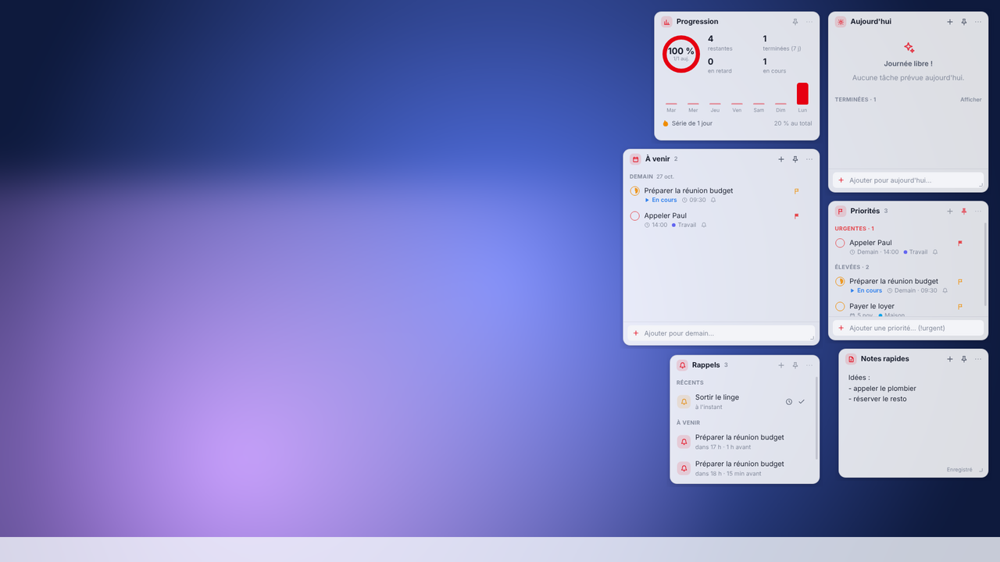
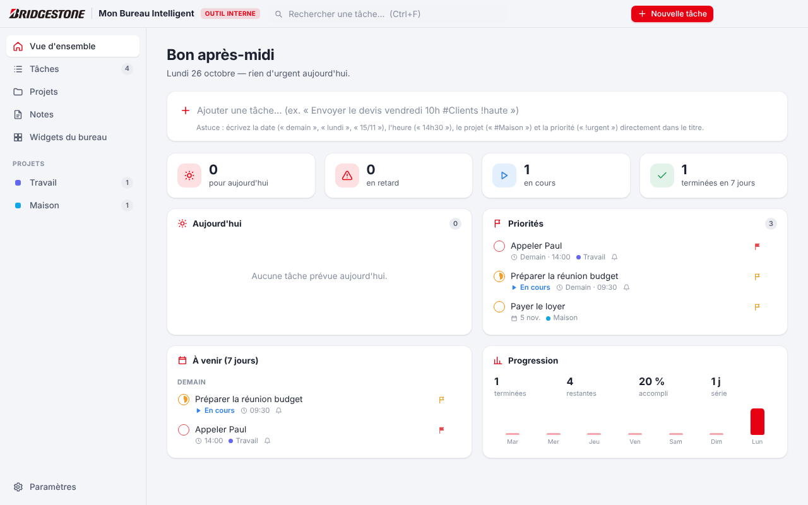
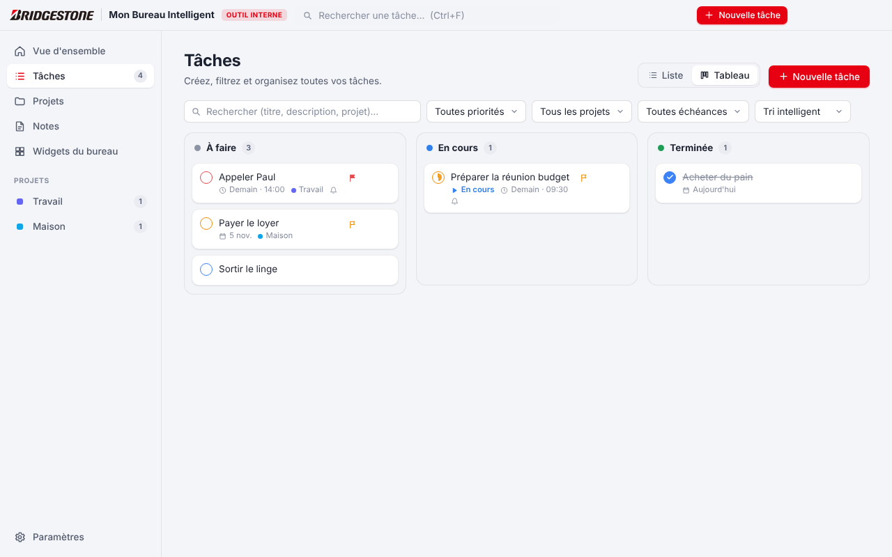
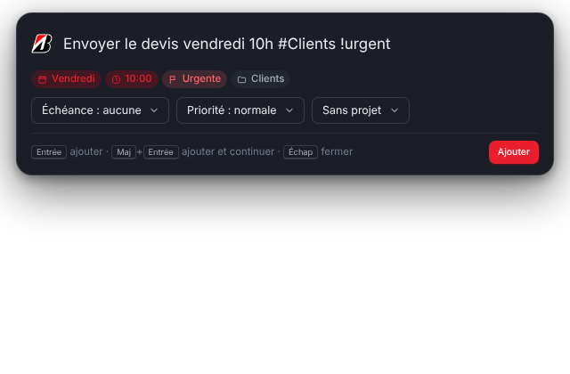
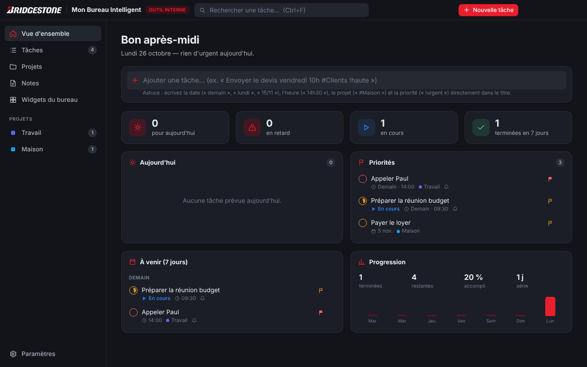
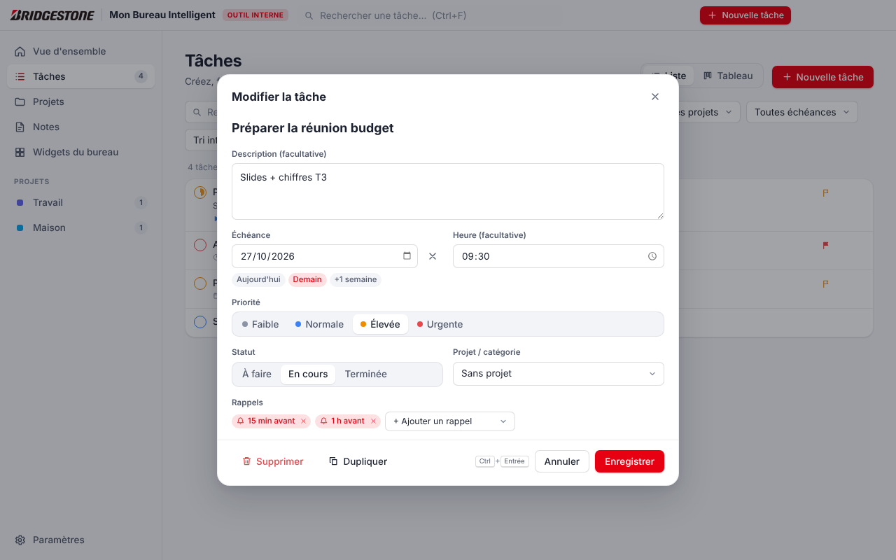
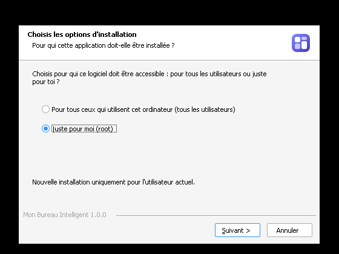
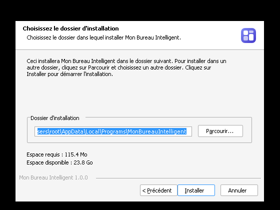
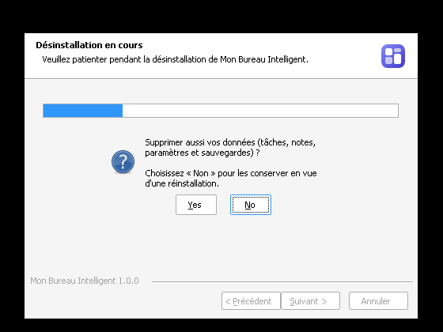

# Mon Bureau Intelligent — Bridgestone


**Outil interne** aux couleurs de Bridgestone (logo, rouge Bridgestone par défaut).

**Gestionnaire de tâches pour Windows 10 et 11, avec vos tâches affichées en widgets directement sur le bureau.**

Chaque widget est une vraie fenêtre Windows indépendante : vous le déplacez, le redimensionnez, l'affichez ou le masquez, et il garde sa place après un redémarrage. L'application fonctionne entièrement hors ligne, sans compte ni abonnement, et n'envoie aucune donnée.



> Composition réalisée à partir de captures réelles des widgets (fond d'écran ajouté pour l'illustration).

| Tableau de bord | Tableau (kanban) | Saisie rapide |
| --- | --- | --- |
|  |  |  |
|  |  |  |

---

## Sommaire

1. [Fonctionnalités](#1-fonctionnalités)
2. [Installation](#2-installation)
3. [Utilisation](#3-utilisation)
4. [Données, sauvegardes et confidentialité](#4-données-sauvegardes-et-confidentialité)
5. [Architecture technique](#5-architecture-technique)
6. [Compiler le logiciel](#6-compiler-le-logiciel)
7. [Tests](#7-tests)
8. [Limitations connues](#8-limitations-connues)
9. [Structure du projet](#9-structure-du-projet)

---

## 1. Fonctionnalités

### Huit widgets indépendants sur le bureau

| Widget | Contenu |
| --- | --- |
| **Mes tâches** | Toutes les tâches, filtres À faire / En cours / Terminées / Toutes, recherche. |
| **Aujourd'hui** | Tâches du jour, tâches en retard (avec « Tout à aujourd'hui »), tâches terminées du jour. |
| **À venir** | Tâches des prochains jours (7 par défaut, réglable de 3 à 30), regroupées par date. |
| **Priorités** | Tâches urgentes puis élevées. |
| **Projets** | Tâches regroupées par projet, avec progression et ajout direct dans un projet. |
| **Notes rapides** | Bloc-notes à onglets, enregistrement automatique. |
| **Rappels** | Rappels récents (Reporter / Terminer) et prochains rappels. |
| **Progression** | Anneau de progression du jour, statistiques, histogramme sur 7 jours, série de jours. |

Chaque widget peut être :

- **déplacé** en le saisissant par son titre ; il s'aimante aux bords de l'écran et aux autres widgets ;
- **redimensionné** par ses bords gauche, droit, bas et par ses coins inférieurs ;
- **affiché ou masqué** individuellement (menu « … » du widget, zone de notification ou page *Widgets du bureau*) ;
- **épinglé au premier plan** (icône punaise) pour rester visible au-dessus des autres logiciels.

Position, taille, visibilité et mode « premier plan » sont mémorisés.

**Deux façons de rester visible :**

- **Posés sur le bureau** (par défaut) : les widgets passent *sous* vos fenêtres, comme des éléments du bureau. Quand vous affichez le bureau (**Win+D** ou clic sur le fond d'écran), ils restent visibles devant le fond d'écran, puis repassent derrière dès que vous revenez à une application. Le raccourci `Ctrl+Alt+W` les affiche/masque à tout moment.
- **Au premier plan** (punaise) : le widget reste au-dessus de toutes les applications.

**Mode discret** (activé par défaut) : un widget épinglé au premier plan s'efface automatiquement derrière une fenêtre maximisée ou en plein écran (vidéo, jeu, présentation), puis revient.

Autres options : opacité du fond (transparence légère), estompage des widgets inactifs, verrouillage de la disposition, réinitialisation de la disposition.

### Gestion des tâches

Chaque tâche contient : **titre**, **description** facultative, **date d'échéance**, **heure** facultative, **priorité** (faible, normale, élevée, urgente), **projet / catégorie**, **statut** (à faire, en cours, terminée) et des **rappels configurables** (jusqu'à 10 par tâche : à l'échéance, 5 min, 10 min, 15 min, 30 min, 1 h, 2 h, 1 jour, 2 jours, 1 semaine avant, ou date et heure précises).

- Création, modification, suppression, duplication, recherche (sans tenir compte des accents ni des majuscules), filtres (statut, priorité, projet, échéance), tri (intelligent, échéance, priorité, date de création, titre).
- Vue **liste** ou **tableau** (kanban) avec glisser-déposer entre « À faire », « En cours » et « Terminée ».
- Menu contextuel (clic droit) sur chaque tâche : terminer, changer de statut, de priorité, d'échéance, de projet, reporter d'un jour, modifier, dupliquer, supprimer.
- Une case à cocher suffit pour terminer une tâche, depuis n'importe quel widget.

### Saisie rapide en langage naturel

Depuis un widget, le tableau de bord ou le **raccourci clavier global `Ctrl+Alt+N`** (utilisable depuis n'importe quel logiciel) :

```
Appeler Paul demain 14h30 #Travail !urgent
```

crée la tâche « Appeler Paul », pour demain à 14:30, dans le projet « Travail » (créé s'il n'existe pas), en priorité urgente. Un aperçu de ce qui a été compris s'affiche pendant la frappe.

| Élément | Exemples reconnus |
| --- | --- |
| Date | `aujourd'hui`, `auj`, `demain`, `après-demain`, `lundi` … `dimanche`, `mardi prochain`, `semaine prochaine`, `ce week-end`, `dans 3 jours`, `dans 2 semaines`, `dans 1 mois`, `15/11`, `15/11/2027`, `14 juillet`, `le 5`, `ce soir`, `ce matin` |
| Heure | `14h`, `14h30`, `14 h 30`, `9:15`, `à midi` |
| Priorité | `!urgent`, `!haute` (ou `!élevée`, `!important`), `!normale`, `!faible` (ou `!basse`), `!!` (élevée), `!!!` (urgente) |
| Projet | `#Maison`, `#Projet-Été` |

Une heure seule (« Appeler 14h ») place la tâche aujourd'hui, ou demain si l'heure est passée.

### Rappels et notifications

- **Notifications Windows** natives (cliquables : ouvrent la tâche).
- **Fenêtre de rappel** en bas à droite avec *Terminer*, *Reporter* (5 min à demain) et *Ouvrir* — elle fonctionne même si les notifications Windows sont désactivées ou en mode « Ne pas déranger ». Petit carillon (désactivable).
- **Résumé quotidien** à l'heure choisie (« 3 tâches aujourd'hui, 1 en retard »).
- Rappel par défaut (15 min avant) ajouté aux nouvelles tâches avec heure ; heure de référence (09:00) pour les tâches sans heure.
- Après une mise en veille ou un arrêt du PC, les rappels manqués depuis moins de 12 h sont affichés ; les plus anciens sont ignorés silencieusement.

### Tableau de bord complet

Vue d'ensemble (statistiques, aujourd'hui, priorités, à venir, progression), Tâches, Projets (couleurs, progression), Notes, Widgets du bureau, Paramètres. Ouverture : clic sur l'icône de la zone de notification, `Ctrl+Alt+B`, ou relance de l'application.

### Intégration Windows

- Icône dans la **zone de notification** avec menu complet (nouvelle tâche, widgets, verrouillage, mode discret, démarrage automatique, paramètres, quitter) et info-bulle « 3 tâches aujourd'hui, 1 en retard ».
- **Démarrage automatique avec Windows** (configurable ; au démarrage de session, seuls les widgets apparaissent).
- **Raccourcis clavier globaux** configurables : nouvelle tâche (`Ctrl+Alt+N`), afficher/masquer les widgets (`Ctrl+Alt+W`), tableau de bord (`Ctrl+Alt+B`). Un raccourci déjà pris par un autre logiciel est signalé.
- Une seule instance à la fois (relancer l'application ouvre le tableau de bord).

### Apparence

Design moderne et minimaliste, coins arrondis, ombres discrètes, transparence réglable des widgets, **mode clair / sombre / automatique** (suit Windows), **rouge Bridgestone par défaut, 8 autres couleurs d'accent + couleur personnalisée**, logotype Bridgestone (adapté au thème clair ou sombre), trois tailles de texte, animations légères (désactivables, et respect du réglage Windows « réduire les animations »), police Segoe UI Variable de Windows 11. Interface entièrement en français.

---

## 2. Installation

Deux fichiers sont fournis (Windows 10 / 11, 64 bits) :

| Fichier | Usage |
| --- | --- |
| `MonBureauIntelligent-Setup-1.1.0.exe` | **Installeur** (recommandé) : choix du dossier, raccourcis Menu Démarrer et Bureau, désinstallation propre depuis *Paramètres → Applications*. Ne demande pas les droits administrateur (installation pour l'utilisateur courant, ou pour tous si vous le choisissez). |
| `MonBureauIntelligent-Portable-1.1.0.exe` | **Version portable** : se lance directement, sans installation (par exemple depuis une clé USB). |

| Installeur (français) | Dossier d'installation | Désinstallation |
| --- | --- | --- |
|  |  |  |

> Captures réalisées sous Wine (d'où le style Windows classique des boutons).

### Premier lancement : avertissement SmartScreen

Les exécutables ne sont pas signés numériquement (un certificat de signature est payant). Au premier lancement, Windows peut afficher **« Windows a protégé votre ordinateur »** : cliquez sur **Informations complémentaires**, puis **Exécuter quand même**. Cet avertissement disparaît ensuite.

### Désinstallation

*Paramètres Windows → Applications → Mon Bureau Intelligent → Désinstaller* (ou *Menu Démarrer → clic droit → Désinstaller*). Le désinstalleur :

- supprime le programme et ses raccourcis (Menu Démarrer, Bureau) ;
- retire le lancement automatique au démarrage de Windows ;
- vous **demande** si vous voulez aussi supprimer vos données (réponse « Non » par défaut, pour pouvoir réinstaller sans rien perdre).

---

## 3. Utilisation

1. Au premier lancement, le tableau de bord s'ouvre et quatre widgets apparaissent à droite de l'écran : *Aujourd'hui*, *Priorités*, *Progression* et *Notes rapides*.
2. Tapez une tâche dans le champ « Ajouter une tâche… » d'un widget et validez avec **Entrée**.
3. Cochez le cercle à gauche d'une tâche pour la terminer. **Double-clic** sur une tâche pour la modifier, **clic droit** pour le menu complet.
4. Déplacez un widget par son titre, redimensionnez-le par ses bords. Bouton **punaise** : toujours au premier plan. Bouton **…** : options (opacité, verrouillage, masquer…).
5. Activez d'autres widgets depuis la page **Widgets du bureau** ou le menu de la zone de notification.
6. Fermer le tableau de bord le réduit dans la zone de notification : widgets et rappels continuent de fonctionner. Pour quitter : clic droit sur l'icône → **Quitter**.

**Raccourcis dans le tableau de bord :** `Ctrl+N` nouvelle tâche, `Ctrl+F` recherche, `Ctrl+Entrée` enregistrer dans l'éditeur, `Échap` fermer.

---

## 4. Données, sauvegardes et confidentialité

- **Stockage :** base **SQLite** locale (journalisation WAL, écriture synchrone complète) dans
  `%APPDATA%\Mon Bureau Intelligent\donnees\mon-bureau.db`. Tout est enregistré **immédiatement et automatiquement** ; les données survivent aux redémarrages et aux coupures.
- **Sauvegardes automatiques :** une copie par jour dans `…\donnees\sauvegardes\` (les 7 dernières sont conservées), restaurables depuis *Paramètres → Données*. Une sauvegarde est aussi créée avant chaque import.
- **Récupération :** si la base est endommagée (coupure de courant, disque défaillant), elle est mise de côté et la dernière sauvegarde valide est restaurée automatiquement, avec un message explicatif.
- **Export / import** au format JSON (*Paramètres → Données*) : remplacement complet ou fusion.
- **Journaux** techniques locaux : `%APPDATA%\Mon Bureau Intelligent\journaux\` (`main.log`, et `chien-de-garde.log` en cas d'intervention).
- **Confidentialité :** aucun compte, aucun service en ligne, aucune télémétrie, aucune connexion réseau. La version installée et la version portable partagent les mêmes données.

---

## 5. Architecture technique

### Choix : Electron + React + TypeScript (et pas Tauri)

Le cahier des charges demandait d'analyser les contraintes des widgets Windows et de privilégier la fiabilité :

| Contrainte | Electron | Tauri |
| --- | --- | --- |
| Fenêtres sans cadre, transparentes, multiples | Mature et largement éprouvé | Possible, mais transparence + WebView2 + multi-fenêtres moins rodés |
| Compilation de l'`.exe` hors Windows | Oui (electron-builder + Wine), reproductible | Croisée expérimentale (NSIS uniquement, toolchain MSVC/xwin) |
| Rendu identique sur tous les PC | Chromium embarqué | Dépend de la version de WebView2 installée |
| Appels Win32 (détection « Afficher le bureau », mode discret) | Koffi (FFI, binaire précompilé, aucune compilation) | Rust natif |
| Taille | ~120 Mo | ~10 Mo |

**Electron l'emporte en fiabilité** (le critère prioritaire) au prix d'une taille plus importante.

- **Stockage : SQLite intégré à Node.js (`node:sqlite`)**, disponible dans Electron 44 : vraie base SQLite **sans aucun module natif à compiler**, ce qui supprime la principale source de pannes de packaging (better-sqlite3 & co).
- **Win32 : [Koffi](https://koffi.dev)** (seule dépendance d'exécution, licence MIT), qui embarque son binaire Windows précompilé. Volontairement limité à des **lectures** et à des réglages sur **nos propres fenêtres** — aucune relation n'est créée avec les fenêtres de l'Explorateur Windows (la technique classique « propriétaire = Progman » a été écartée : elle lie les files d'entrée de l'application à celles de l'Explorateur et détruit les widgets quand l'Explorateur redémarre). Il sert à :
  - **détecter « Afficher le bureau »** (fenêtre active = `Progman`/`WorkerW`, via `GetForegroundWindow` + `GetClassNameW`) pour garder les widgets visibles, puis les replacer derrière l'application suivante (`SetWindowPos`) ;
  - **mode discret** : détection d'une fenêtre active maximisée ou plein écran (`IsZoomed`, `GetWindowRect`, `GetMonitorInfoW`) sur le même écran ;
  - **style « fenêtre outil »** (`WS_EX_TOOLWINDOW`) : les widgets n'encombrent ni la barre des tâches ni Alt+Tab.
  - **Garde-fou :** le premier appel de chaque fonction native est encadré par un fichier témoin. Si un appel ne rendait jamais la main, le lancement suivant désactive automatiquement l'intégration (message dans *Paramètres*, bouton « Réactiver »), et l'application fonctionne avec le comportement standard d'Electron. Toute autre erreur native est journalisée sans jamais bloquer l'application.
  - **Chien de garde :** pendant les deux premières minutes, un petit processus séparé surveille les battements du processus principal ; s'il se figeait plus de 15 s, il serait arrêté puis relancé automatiquement (une seule fois), sans l'intégration Win32. Ce mécanisme a été validé sur l'exécutable Windows réel (voir `docs/BILAN.md`).
- **Redimensionnement des widgets :** poignées dessinées dans l'interface et pilotées par le processus principal (les fenêtres transparentes Windows n'ont pas de bordure de redimensionnement système).
- **Sécurité :** `contextIsolation`, `sandbox`, pas de `nodeIntegration`, politique CSP stricte (`script-src 'self'`, `connect-src 'none'`), navigation et ouverture de fenêtres bloquées, origine vérifiée sur chaque appel IPC, **toutes les données validées dans le processus principal** avant écriture (messages d'erreur en français).

### Organisation en couches

```
Interface (React)  ──IPC typé et validé──▶  Processus principal (Electron)
  src/renderer/                               src/main/  (fenêtres, zone de notification, raccourcis, rappels, Win32)
                                                   │
                         Logique métier partagée ◀─┤  src/shared/  (types, validation, dates, requêtes,
                         (TypeScript pur, testé)   │               statistiques, saisie rapide, rappels)
                                                   ▼
                                         Stockage : src/main/storage/ (SQLite, migrations, sauvegardes)
                                         Service  : src/main/services/ (règles métier, export/import, planificateur)
```

La logique métier, la validation, le stockage et le planificateur de rappels n'importent pas Electron : ils sont testés directement sous Node.js.

---

## 6. Compiler le logiciel

### Prérequis

- **Node.js 22.13 ou plus récent** (pour les tests, qui utilisent `node:sqlite`) — <https://nodejs.org>
- Sous **Windows** : rien d'autre.
- Sous **Linux** (compilation croisée) : **Wine** (le générateur d'installeur NSIS l'utilise pour le désinstalleur et l'icône). Ubuntu/Debian :
  ```bash
  sudo dpkg --add-architecture i386 && sudo apt-get update
  sudo apt-get install -y wine wine32:i386 wine64
  ```
- macOS : utilisez plutôt la compilation GitHub Actions ci-dessous.

### Commandes exactes

```bash
cd mon-bureau-intelligent
npm ci                     # installe les versions exactes du package-lock.json
npm test                   # tests unitaires et d'intégration (75)
npm run dist:win           # vérif. TypeScript + build + installeur ET portable
npm run verify:release     # contrôle des .exe produits + sommes SHA-256
```

Les fichiers sont produits dans `release/` :

```
release/MonBureauIntelligent-Setup-1.1.0.exe      installeur NSIS
release/MonBureauIntelligent-Portable-1.1.0.exe   version portable
release/win-unpacked/MonBureauIntelligent.exe     application décompressée (test rapide)
```

### Tous les scripts

| Commande | Rôle |
| --- | --- |
| `npm run dev` | Mode développement (rechargement à chaud de l'interface, relance automatique d'Electron) |
| `npm run build` | Vérification TypeScript + compilation interface (Vite) + processus principal (esbuild) dans `dist/` |
| `npm start` | Lance l'application compilée (`dist/`) |
| `npm test` | Tests unitaires et d'intégration (Vitest) |
| `npm run test:e2e` | Tests de bout en bout sur la vraie application (Playwright ; Xvfb automatique sous Linux) — nécessite `npm i -D playwright` |
| `npm run dist:win` | Installeur + portable |
| `npm run dist:win:installer` / `dist:win:portable` | L'un ou l'autre seulement |
| `npm run verify:release` | Vérifie les livrables |
| `npm run icons` | Régénère les icônes et le bandeau de l'installeur depuis les logos de `build/brand/` (nécessite ImageMagick ; les fichiers sont déjà fournis) |

### Compilation sur un Windows « propre » via GitHub Actions

Le fichier `.github/workflows/build-windows.yml` compile, teste et vérifie le logiciel sur une machine Windows de GitHub à chaque envoi sur `main` (ou manuellement : onglet **Actions** → *Compilation Windows* → *Run workflow*). Les `.exe` sont téléchargeables dans l'artefact *MonBureauIntelligent-Windows* de l'exécution. Une étiquette `v*` (ex. `git tag v1.1.0 && git push origin v1.1.0`, ou *Releases → Create a new release* sur GitHub) publie en plus une version dans l'onglet **Releases**.

### Signature de code (facultatif)

Pour supprimer l'avertissement SmartScreen, il faut un certificat de signature de code (payant). electron-builder signe automatiquement si les variables `CSC_LINK` (fichier .pfx) et `CSC_KEY_PASSWORD` sont définies au moment de `npm run dist:win`.

---

## 7. Tests

| Suite | Commande | Contenu |
| --- | --- | --- |
| Unitaires et intégration | `npm test` | 75 tests : dates (y compris changement d'heure), validation et messages d'erreur, saisie rapide en français, vues des widgets, filtres et recherche, statistiques, rappels, base SQLite réelle (persistance, migrations, corruption + restauration automatique, rotation des sauvegardes), service (CRUD, règles métier, import/export, fusion), planificateur de rappels, garde-fou Win32, chien de garde |
| Bout en bout | `npm run test:e2e` | 26 vérifications sur la vraie application Electron : fenêtres widgets séparées, création depuis le tableau de bord / un widget / la saisie rapide, validation, éditeur complet, recherche, case à cocher, notes, affichage/masquage, premier plan, mémorisation des positions, aimantation, redimensionnement à la souris, menus natifs, stress d'ouverture/fermeture, fenêtre de rappel, thème sombre, **persistance après redémarrage**, journal sans erreur ; captures d'écran dans `docs/captures/` |
| Livrables | `npm run verify:release` | En-têtes PE x64, application graphique, installeur NSIS, contenu de l'archive, module Win32 présent, icônes, SHA-256 |
| Exécutable réel sous Wine | (manuel) | Démarrage du `.exe` Windows, SQLite, chargement du module Win32, chien de garde et garde-fou — voir le bilan |

Le bilan détaillé des tests effectués pour cette version (et de ce qui n'a pas pu être testé) est dans [`docs/BILAN.md`](docs/BILAN.md).

---

## 8. Limitations connues

- **Bureaux virtuels Windows :** un widget appartient au bureau virtuel sur lequel il a été créé (Electron ne permet pas l'affichage sur tous les bureaux virtuels sous Windows).
- **Tests sur Windows :** le logiciel a été développé et testé sous Linux, et son exécutable Windows sous Wine (voir [`docs/BILAN.md`](docs/BILAN.md)) ; il n'a pas pu être essayé sur un vrai PC Windows 10/11. Les fonctions propres à Windows (installation, notifications, démarrage automatique, intégration Win32) reposent sur des API standard d'Electron ou sont protégées par le garde-fou et le chien de garde décrits au §5.
- **Exécutables non signés :** avertissement SmartScreen au premier lancement (voir §2).
- **Notifications de la version portable :** sur certaines configurations, Windows n'affiche les notifications natives que pour les applications installées (raccourci Menu Démarrer). La **fenêtre de rappel intégrée** fonctionne dans tous les cas.
- **Raccourcis globaux :** un raccourci déjà réservé par un autre logiciel ne peut pas être utilisé ; il est signalé « Indisponible » dans les paramètres et vous pouvez en choisir un autre.
- **Mises à jour du logiciel :** pas de mise à jour automatique (aucun serveur). Pour mettre à jour, lancez simplement le nouvel installeur : les données sont conservées.
- **Taille :** environ 120 Mo, le prix d'un moteur d'affichage Chromium embarqué (rendu identique sur tous les PC, fonctionnement hors ligne).

---

## 9. Structure du projet

```
mon-bureau-intelligent/
├── src/
│   ├── shared/            Logique métier pure (types, validation, dates, requêtes, saisie rapide, rappels, API IPC)
│   ├── main/
│   │   ├── index.ts       Démarrage, cycle de vie, coordination
│   │   ├── ipc.ts         Points d'entrée IPC (origine vérifiée, menus contextuels natifs)
│   │   ├── storage/       SQLite : ouverture, migrations, récupération, sauvegardes, dépôts
│   │   ├── services/      Service de données (règles métier, import/export), planificateur de rappels
│   │   ├── windows/       Widgets, tableau de bord, saisie rapide, fenêtre de rappel
│   │   ├── platform/      Intégration Win32 (Koffi)
│   │   ├── tray.ts        Zone de notification
│   │   ├── watchdog.ts    Chien de garde du démarrage
│   │   └── system.ts      Démarrage automatique, raccourcis globaux, notifications
│   ├── preload/           Pont sécurisé (contextBridge)
│   └── renderer/          Interface React : widgets/, dashboard/, quickadd/, reminder/, components/, styles/
├── tests/                 shared/ et main/ (Vitest), e2e/ (Playwright + Electron)
├── build/                 Icônes (SVG, ICO, PNG) et script NSIS personnalisé
├── resources/             Icônes livrées avec l'application (zone de notification, notifications)
├── scripts/               Build esbuild, mode dev, génération d'icônes, vérification des livrables
├── docs/                  Captures d'écran, bilan des tests
├── electron-builder.yml   Packaging Windows (NSIS + portable)
└── .github/workflows/     Compilation Windows automatisée
```

Licence : MIT.
